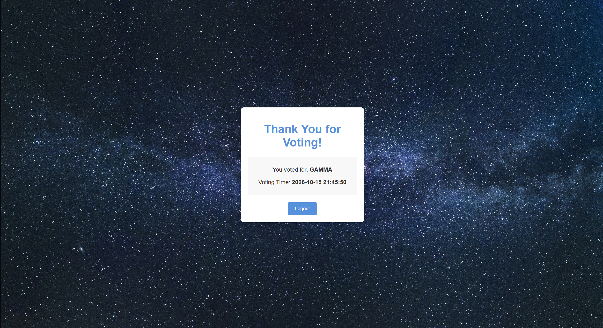
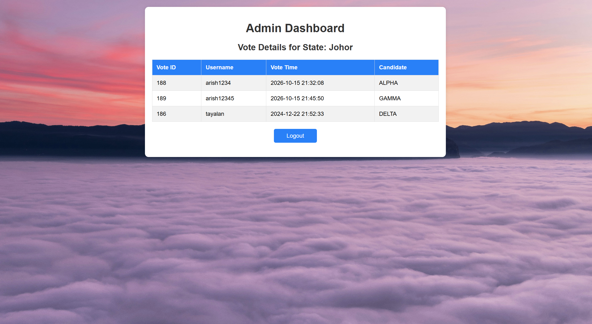

# Online Voting System

A web-based voting system where registered voters verify their identity against a voter register before casting a single vote, and state administrators log in with a time-limited TAC to monitor votes for their state. Built as my BSc Software Engineering final year project (APU & De Montfort University).

**Tech stack:** PHP, MySQL, HTML, CSS, JavaScript

## Screenshots

<!-- Save screenshots in docs/screenshots/ and they will show here -->
| Identity verification | Ballot |
|---|---|
|  |  |

| Vote confirmation | Admin dashboard |
|---|---|
|  |  |

## How it works

1. **Sign up and sign in** with a username and password (passwords hashed with `password_hash`).
2. **Verify identity:** the voter enters their IC number and state, which are checked against the voter register (`votersdataset` table). Each IC number can be linked to only one account.
3. **Vote:** verified voters choose a candidate on the ballot. The vote is recorded with a server timestamp, and a voter cannot vote twice.
4. **Admin monitoring:** an administrator enters their admin ID and state to receive a 6-digit TAC that expires after 5 minutes. After verifying the TAC, they see the votes cast in their state.

## Features

- Voter registration and login with hashed passwords
- Identity verification against a voter register (IC number + state)
- One IC number per account, and one vote per voter
- Ballot page that only verified voters can reach
- Vote confirmation showing the chosen candidate and voting time
- Admin login with a time-limited, single-use TAC
- State-based admin dashboard listing votes for that state

## Security

- Prepared statements for all database queries (prevents SQL injection)
- Voting pages check that the user is signed in **and** identity-verified
- Candidate choice validated against the database before a vote is saved
- TAC generated with a cryptographically secure random number, valid for 5 minutes and deleted after use
- Session ID regenerated on login (prevents session fixation)
- Database credentials kept out of Git (`config/config.php` is ignored)

## Known limitations

This is an academic prototype, not a production election system:

- The TAC is shown on screen to simulate delivery. A real system would send it by SMS or email, and admins would also need a password.
- Votes are stored with a link to the voter's account, so the ballot is not anonymous.

## Project structure

```
Admin/      Admin TAC login, verification, dashboard and logout
cand_icon/  Candidate images
config/     Database connection and settings
database/   SQL export and the sample voter register (CSV)
images/     Page background images
index.php   Ballot page
signup.php, signin.php, verify_identity.php, vote.php
```

## Run it locally

1. Install [XAMPP](https://www.apachefriends.org/) and start **Apache** and **MySQL**.
2. Clone this repo into `C:\xampp\htdocs`:
   ```
   git clone https://github.com/arish-tayalan/online-voting-system.git voting_system
   ```
3. Open http://localhost/phpmyadmin, create a database named `voting_system`, and import `database/voting_system.sql`.
4. Copy `config/config.example.php` to `config/config.php` and edit the values if your setup differs.
5. Visit http://localhost/voting_system/signup.php to register, then sign in. To test identity verification, use any IC number and state from `database/voters_dataset.csv`.

## Testing

The system went through unit testing and user acceptance testing (UAT) as part of the BSc project.

## Author

**Arish Tayalan** · [LinkedIn](https://www.linkedin.com/in/arish-tayalan) · [GitHub](https://github.com/arish-tayalan)
